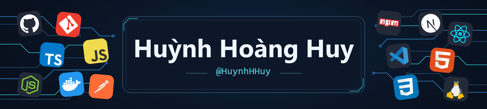
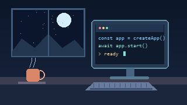

  

  
   
  

---

### About Me

**Name** · Huỳnh Hoàng Huy  
**GitHub** · [@HuynhHHuy](https://github.com/HuynhHHuy)  
**Languages** · TypeScript, JavaScript  
**Web stack** · Next.js, React, Node.js  
**Tools** · Git, GitHub, Docker, Postman, npm  

[Public repositories](https://github.com/HuynhHHuy?tab=repositories)

 

---

### Tech Stack

         

---

### GitHub Stats

  
  

  

Language card excludes HTML · <a href="https://github.com/HuynhHHuy#js-contribution-activity">Commit activity on GitHub</a>

